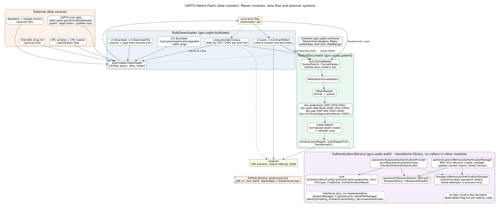

# Architecture

This document describes the current `master` branch of COG-GTM/USPTO-Patent-Public-Data: a Maven multi-module
Java toolkit that downloads USPTO bulk patent files, reads the documents inside them into a normalized
Patent object model, and (since the COG-GTM fork) ships a separate authenticator-management library.



Diagram source: [`diagrams/architecture.dot`](diagrams/architecture.dot) (also rendered as
[SVG](diagrams/architecture.svg)). Edit the `.dot` file and run `docs/diagrams/render.sh` (needs Graphviz) to
regenerate both images.

## Build layout

The root `pom.xml` (`gov.uspto:PatentPublicData:0.0.1-SNAPSHOT`) builds four modules in this order:

| Module | Package | Depends on | Role |
| :-- | :-- | :-- | :-- |
| `Common` | `gov.uspto.common` | - | Shared file/archive iterators, file filters, predicates, text utilities, `DateRange`. |
| `PatentDocument` | `gov.uspto.patent` | `Common` | Reads bulk files and parses each patent document into `model.Patent`; validation and JSON serialization. |
| `BulkDownloader` | `gov.uspto.bulkdata` | `Common`, `PatentDocument` | CLIs to download bulk files, view or extract single documents, and build classification-filtered corpora. |
| `AuthenticationService` | `gov.uspto.auth` | - | Standalone authenticator-management library (NIST SP 800-53 IA-5 / AC-7 oriented). Not used by the other modules. |

Code is compiled for Java 8 (`maven-compiler-plugin` source/target `1.8`). The root build also aggregates
Javadoc, copies dependency jars, and packages a binary assembly from `resources/assembly/bin.xml`
(module jars, `lib/dependency-jars`, `conf/log4j.properties`, and the shell scripts in `resources/scripts`).

## Data flow

1. **Download.** `BulkDownloader` fetches zip files into a local directory (default `./download`).
   - `gov.uspto.bulkdata.cli2.BulkData` downloads by `--type grant|application|gazette` and `--date` range from
     the USPTO Open Data Portal (`https://data.uspto.gov/bulkdata/datasets/`; see `cli2.BulkDataType`).
   - `gov.uspto.bulkdata.cli.Download` / `DownloadFile` use the source definitions in
     `BulkDownloader/src/main/resources/sources.xml` (USPTO, Reedtech and Google mirrors, CPC scheme and CPC
     master classification files, FDA NDC drug list).
   - `downloader.Downloader` does the HTTP work with OkHttp, including async downloads, retries and restarts.
2. **Read.** `PatentDocument`'s `bulk.DumpReader` implementations (`DumpFileXml`, `DumpFileAps`) iterate the
   individual documents inside a bulk zip. `PatentDocFormatDetect` identifies the format and `PatentReader`
   dispatches to the matching parser:
   - `doc.greenbook` - APS Greenbook text, 1976-2001
   - `doc.sgml` - Red Book SGML, 2001-2004
   - `doc.pap` - Patent Application Publication XML, 2002-2004
   - `doc.xml` - `GrantParser` / `ApplicationParser` for Red Book XML, 2004 onward
3. **Normalize.** Every parser produces the same `model.Patent` object model (document ids, parties,
   classifications, claims with a claim tree, citations, formatted text). `validate` contains field rules
   (title, abstract, claims, description, classification).
4. **Output.**
   - `gov.uspto.patent.TransformerCli` writes JSON via `serialize.JsonMapper` / `JsonMapperFlat`.
   - `gov.uspto.bulkdata.cli.Look` prints or writes one document (raw XML, object, or JSON);
     `cli.ExtractPatent` extracts raw documents from a bulk file.
   - `gov.uspto.bulkdata.corpusbuilder.Corpus` downloads one bulk file at a time for a date range, keeps the
     documents that match the given CPC / USPC classifications, writes them out, and moves to the next file.

The scripts in `resources/scripts` (`download.sh`, `download_date.sh`, `look.sh`, `corpusBuilder.sh`,
`download.bat`) wrap these main classes with the classpath of the binary assembly. See the module READMEs
([BulkDownloader](../BulkDownloader/README.md), [PatentDocument](../PatentDocument/README.md)) for options.

## AuthenticationService

A library for managing authenticators (credentials) in line with NIST SP 800-53 IA-5 (authenticator
management) and AC-7 (unsuccessful logon attempts). No class in `Common`, `PatentDocument` or
`BulkDownloader` references it; it is built and tested with the rest of the reactor.

- **`core`** - `AuthenticationConfig` loads `authentication.properties` from the classpath (none is shipped;
  defaults apply) and lets environment variables override each key (`auth.max.login.attempts` ->
  `AUTH_MAX_LOGIN_ATTEMPTS`). Defaults: 12-character passwords with complexity, 90-day expiry, 3 failed
  attempts then a 15-minute lockout, 30-minute sessions, 60-minute tokens. Also holds `Principal`,
  `Credential`, `AuthenticationResult` and exceptions.
- **`authenticator`** - `AuthenticatorManager` and its `InMemoryAuthenticatorManager` implementation cover the
  authenticator lifecycle: create, validate, update (with password-history check), revoke, expire, renew,
  and lock out after failed attempts. Types: `PASSWORD`, `PKI_CERT`, `HARDWARE_TOKEN`, `API_KEY`; statuses:
  `ACTIVE`, `EXPIRED`, `REVOKED`, `LOCKED`.
- **`password`** - `PasswordHasher` (jBCrypt), `PasswordPolicy`, `PasswordValidator`,
  `PasswordAuthenticationProvider`.
- **`pki`** - `PKIAuthenticationProvider` with certificate validation.
- **`mfa`** - `MultiFactorAuthenticator` combines registered providers under an `MFAPolicy`
  (`createDefault()`, `createPrivilegedPolicy()`).
- **`storage`** - `AuthenticationStorage` with `InMemoryAuthenticationStorage` (authenticators, password
  history, failed-attempt counters). State lives in process memory only; there is no persistent store.
- **Interfaces without implementations** - `session.SessionManager`, `crypto.CryptoService`,
  `identifier.IdentifierManager`, `proofing.IdentityProofing`, `policy.AuthenticationPolicy`,
  `service.ServiceAuthenticator`.
- **FIPS / FedRAMP status** - `bc-fips` and `bcpkix-fips` are declared in `AuthenticationService/pom.xml` and
  `AuthenticationConfig` has a `fipsEnabled` flag (default `false`), but no code imports BouncyCastle or reads
  the flag yet, and hashing uses jBCrypt. Treat the module as preparation for FIPS mode, not FIPS-validated.

## Build, test and CI

```bash
mvn -B test            # all four modules; JDK 8 or 17
mvn -B package         # jars, aggregated Javadoc and the binary assembly
```

`.github/workflows/sonarcloud.yml` runs on pushes and pull requests to `master`: JDK 17,
`mvn -B verify -DskipTests` and a SonarCloud scan. Tests are not run in CI, and `sonar-project.properties`
lists only `Common`, `PatentDocument` and `BulkDownloader` sources, so `AuthenticationService` is not
analysed.
